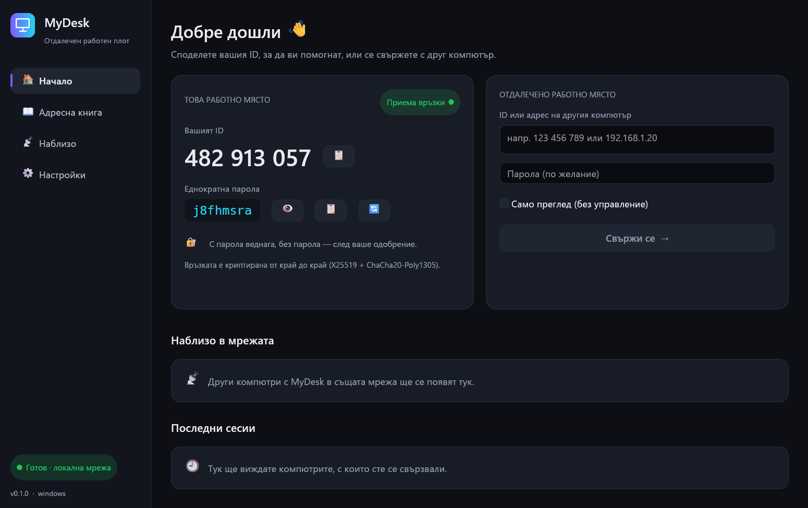
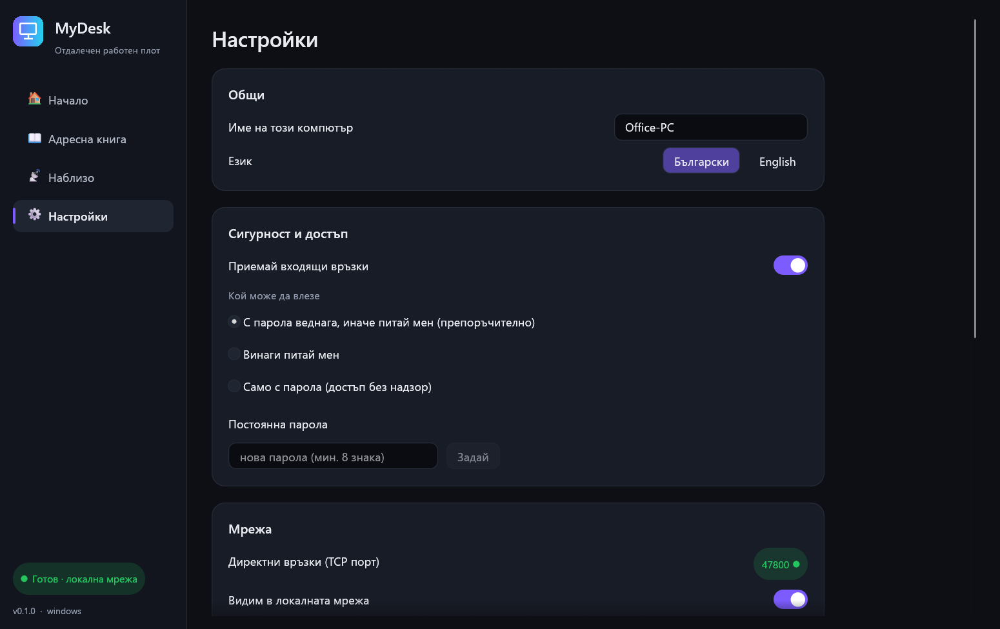

<div align="center">


# MyDesk

**Бърз, криптиран отдалечен работен плот за Windows и Linux.**
<br>
*Fast, end-to-end encrypted remote desktop for Windows & Linux — written in Rust.*

[](https://github.com/Krumqnkata/mydesk/releases/latest)
[](https://github.com/Krumqnkata/mydesk/actions/workflows/ci.yml)
[](LICENSE)


[**⬇ Изтегли / Download**](https://github.com/Krumqnkata/mydesk/releases/latest) · [Български](#-български) · [English](#-english)



</div>

---

## 🇧🇬 Български

### Какво може

| | |
|---|---|
| 🆔 **ID и еднократна парола** | Всеки компютър има 9-цифрен ID. Дайте ID-то и паролата — и сте свързани. |
| ✅ **Прозорец за одобрение** | Без парола другата страна натиска „Приеми“, „Само преглед“ или „Откажи“. |
| 🔐 **Криптиране от край до край** | X25519 + ChaCha20-Poly1305. Паролата никога не минава по мрежата. Код за сигурност за проверка. |
| 🎮 **Плавна картина** | H.264 до 144 кадъра/сек, многоядрено кодиране, избор на качество и резолюция. |
| 🔤 **Остър текст** | Режим „без загуби“ — изпраща само променените части от екрана. |
| 🖱 **Пълно управление** | Мишка, колело, клавиатура по физически клавиш (работи с кирилица), Ctrl+Alt+Del, Win, Alt+Tab. |
| 📋 **Споделен клипборд** | Копирате тук — поставяте там, и обратно. |
| 📁 **Файлове** | Пуснете файл върху екрана или натиснете 📁. Записват се в „Изтегляния/MyDesk“. |
| 💬 **Чат** | Между двете страни по време на сесия. |
| 🖥 **Няколко монитора** | Превключване с един клик. |
| 📡 **Наблизо** | Автоматично открива компютри с MyDesk в локалната мрежа. |
| 🌍 **Relay сървър** | Връзка по ID през интернет чрез собствен сървър (`mydesk --relay`). |
| 📊 **Статистика** | Кадри/сек, забавяне, Mbps, резолюция, кодек. |
| 🗂 **Адресна книга** | Последни сесии, любими, преименуване, запомнени пароли. |



### Инсталиране

1. Изтеглете от [Releases](https://github.com/Krumqnkata/mydesk/releases/latest):
   - **Windows:** `mydesk-windows-x64.zip` → разархивирайте → `mydesk.exe`
   - **Linux:** `mydesk-linux-x64.tar.gz` → `tar xzf …` → `./mydesk`
2. При първо пускане Windows може да попита за защитната стена — разрешете, за да могат други да се свързват.

### Как се свързвам

- **В една мрежа:** другият компютър се появява в „Наблизо“ — кликнете го. Или въведете IP адреса му.
- **През интернет:** пуснете relay на сървър с публичен адрес и въведете адреса му в *Настройки → Мрежа* на двата компютъра:
  ```bash
  ./mydesk --relay          # порт 47900
  ```
  Relay-ят само препраща криптирани данни и не вижда нищо.

### Клавишни комбинации

| | |
|---|---|
| `Ctrl+Alt+Shift+F` | Цял екран вкл./изкл. |
| Десен бутон върху плочка | Свързване само за преглед, любим, преименуване, премахване |

---

## 🇬🇧 English

### Features

- **ID + one-time password** access, or an **accept prompt** on the remote side (accept / view only / decline).
- **End-to-end encryption:** X25519 key exchange, ChaCha20-Poly1305, HMAC password proof (the password never crosses the wire), short security code to rule out a man in the middle.
- **Two codecs:** H.264 (smooth, up to 144 fps, multi-core) and a **lossless tile codec** (crisp text, only changed regions are sent).
- **Full control:** mouse, wheel, physical-key keyboard (the host's layout decides the character, so Cyrillic and other layouts just work), special keys menu.
- **Clipboard sync, file transfer (drag & drop), chat, multi-monitor, full screen, live stats.**
- **LAN discovery** and an optional **self-hosted relay** for connecting by ID over the internet.
- **Unattended access** with a permanent password; host can revoke control or disconnect at any time.
- UI in **Bulgarian and English**.

### Download

Grab the latest build from **[Releases](https://github.com/Krumqnkata/mydesk/releases/latest)** (Windows x64 zip, Linux x64 tarball).

### Command line

```text
mydesk                       open the app
mydesk --relay [port]        run a relay server (default 47900), no window
mydesk --selftest            loopback check of the whole pipeline (view only)
mydesk --screenshot out.png  render the window once and save a PNG
```

### Build from source

```bash
# Windows: Rust (MSVC) + Visual Studio Build Tools
cargo build --release

# Linux (Debian/Ubuntu)
sudo apt install build-essential pkg-config clang libclang-dev \
  libxcb1-dev libxrandr-dev libdbus-1-dev libpipewire-0.3-dev libspa-0.2-dev \
  libwayland-dev libxkbcommon-dev libgbm-dev libegl1-mesa-dev libxdo-dev
cargo build --release
```

### Ports

| Port | Protocol | Purpose |
|---|---|---|
| 47800 | TCP | direct connections |
| 47801 | UDP | LAN discovery |
| 47900 | TCP | relay server (optional) |

### Architecture

```
capture (DXGI / X11) → resize → RGBA→I420 (parallel) → H.264 slices │ LZ4 tiles
      → bincode → ChaCha20-Poly1305 → TCP (direct or relay) → decode → egui texture
input (egui events) → physical key names → SendInput / XTest on the host
```

### Roadmap

- [ ] Audio streaming
- [ ] GPU hardware encoding (NVENC / QuickSync / VAAPI)
- [ ] Gamepad forwarding
- [ ] Wayland input injection (libei)
- [ ] UDP transport with forward error correction

### Known limitations

- Linux input injection works on **X11** sessions; Wayland can be viewed but not yet controlled.
- Connecting by ID over the internet needs your own relay (no public relay is provided).
- Windows cannot inject into elevated (admin) windows unless MyDesk itself runs as administrator.

---

<div align="center">
<sub>MIT © 2026 Krum · Built with <a href="https://github.com/emilk/egui">egui</a>, <a href="https://github.com/ralfbiedert/openh264-rs">openh264</a>, <a href="https://github.com/nashaofu/xcap">xcap</a> and <a href="https://github.com/enigo-rs/enigo">enigo</a>.</sub>
</div>
